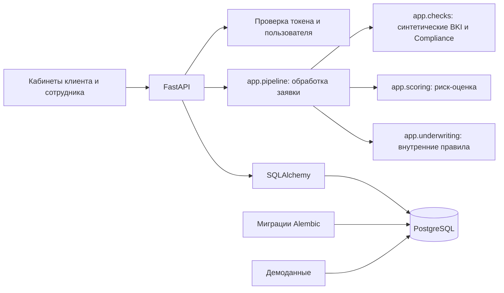
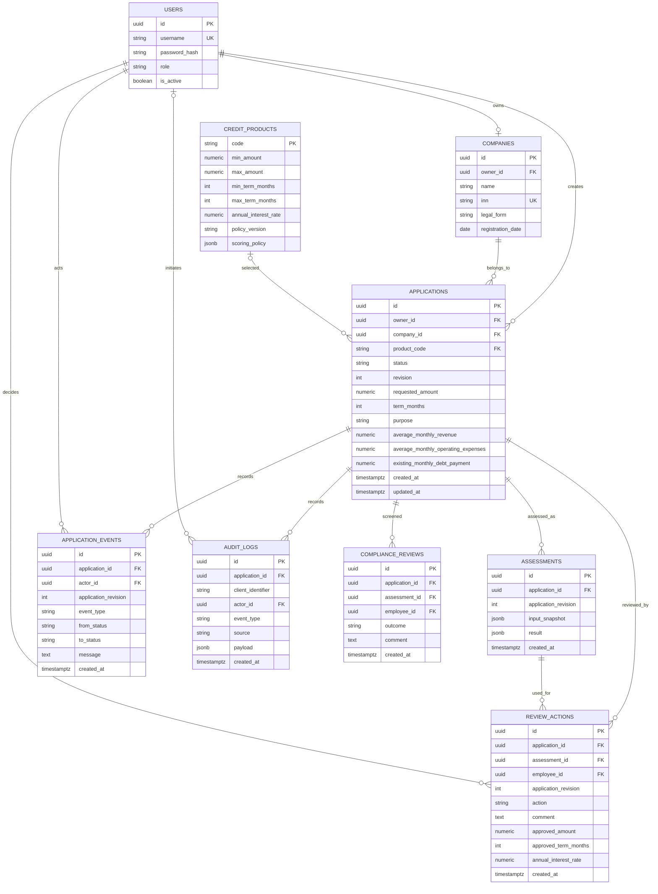

# Устройство backend

Все запросы работают в отдельных сессиях БД. Владелец и компания заявки
определяются сервером из вошедшего пользователя. Обновление черновика проверяет
версию в запросе; SQLAlchemy добавляет проверку версии в UPDATE, поэтому две
параллельные записи не могут незаметно затереть друг друга.

Составной внешний ключ `(company_id, owner_id)` дополнительно запрещает связать
заявку с компанией другого пользователя даже при ошибке прикладного кода.
Деньги хранятся в NUMERIC(15, 2), даты событий — TIMESTAMPTZ; API нормализует UTC.
JSONB используется только для серверных условий скоринга, не вместо колонок анкеты.

Кредитный конвейер вызывает `checks.bki`, `checks.compliance`, затем
`scoring.assess_application` и `underwriting.evaluate_underwriting`. Он хранит
результат каждой проверки в `audit_logs`, а скоринговый снимок и объяснения — в
`assessments`. Экспорт аудита сотруднику доступен как JSON и CSV.

Клиент создаёт черновики, редактирует их в `DRAFT`/`NEEDS_INFO` и отправляет
полную анкету. Backend сохраняет оценку и переводит заявку в `UNDER_REVIEW`.
Создание, редактирование и отправка атомарно записываются в историю событий.
Повторная подача после `NEEDS_INFO` сохраняет новую оценку отдельно от старых.
Очередь и карточку заявки читает только сотрудник банка; незавершённые черновики
сотруднику не видны. Сотрудник может запросить уточнение, одобрить или отклонить
заявку только по актуальной оценке. Событие перехода, комментарий, оценка и
итоговые условия одобрения сохраняются одной транзакцией.

Удалить заявку клиент может только в `DRAFT`; удаление каскадно убирает её
события. Действия сотрудника записываются отдельно и защищены уникальностью
по редакции оценки.

Модуль `app.scoring` — отдельная чистая функция. При отправке backend передаёт
ему анкету, сведения компании и результаты локальных симуляторов. Каждая оценка
сохраняет входной снимок, результат и редакцию заявки.
