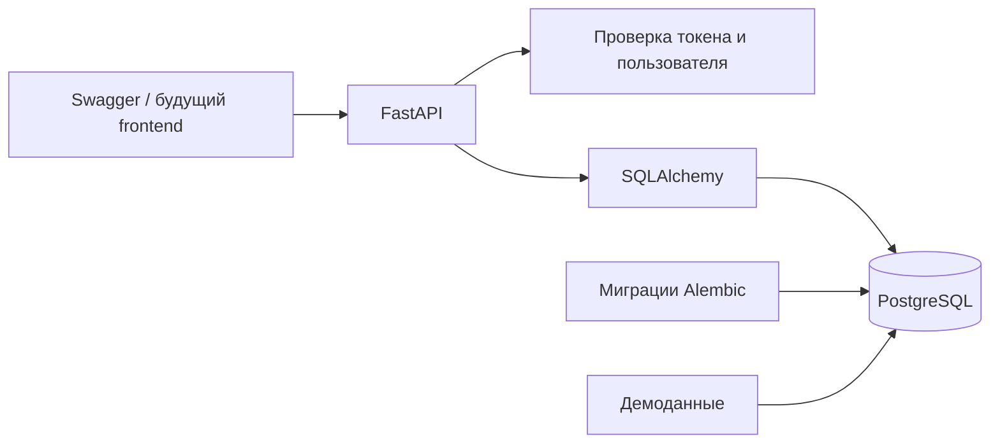
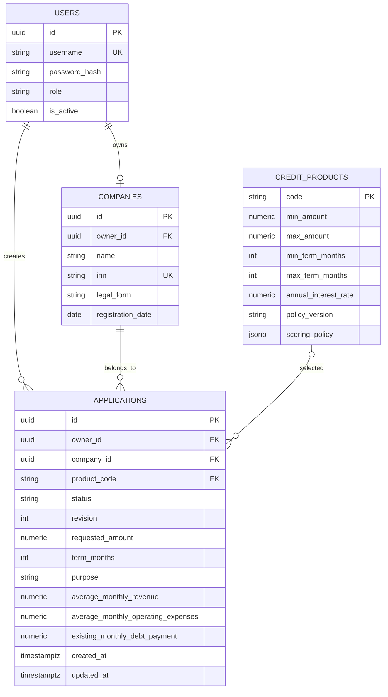

# Устройство backend

Все запросы работают в отдельных сессиях БД. Владелец и компания заявки
определяются сервером из вошедшего пользователя. Обновление черновика проверяет
версию в запросе; SQLAlchemy добавляет проверку версии в UPDATE, поэтому две
параллельные записи не могут незаметно затереть друг друга.

Составной внешний ключ `(company_id, owner_id)` дополнительно запрещает связать
заявку с компанией другого пользователя даже при ошибке прикладного кода.
Деньги хранятся в NUMERIC(15, 2), даты событий — TIMESTAMPTZ; API нормализует UTC.
JSONB используется только для серверных условий скоринга, не вместо колонок анкеты.

В этой задаче API создаёт только `DRAFT`; иных переходов пока нет. PATCH разрешён
для `DRAFT` и зарезервированного `NEEDS_INFO`. Значения остальных состояний
подготовлены в ограничении БД для следующей задачи, но клиент не может их задать.
Таблицы оценок, событий и решений намеренно не добавлены до реализации обработки.

Модуль `app.scoring` — отдельная чистая функция. Тест совместимости демонстрирует
маппинг анкеты и компании к его контракту. В рабочем HTTP-сценарии этой задачи
скоринг ещё не вызывается: отсутствуют отправка и симуляторы внешних проверок.
